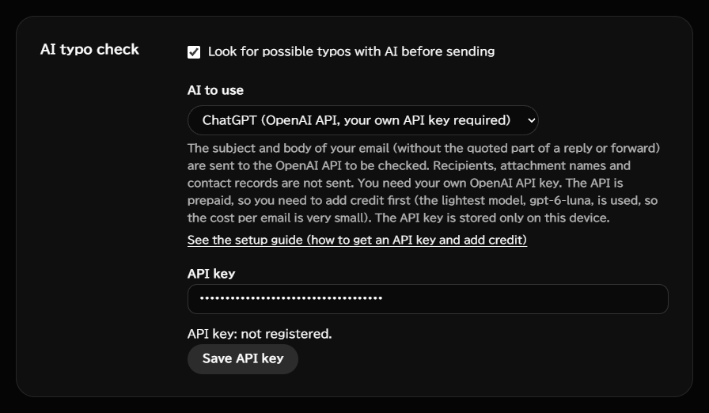
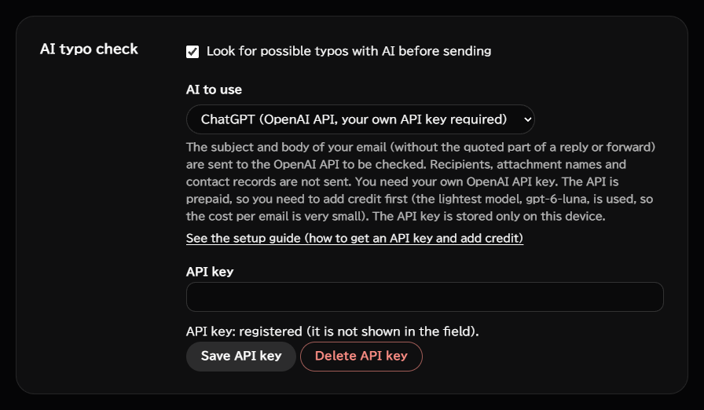
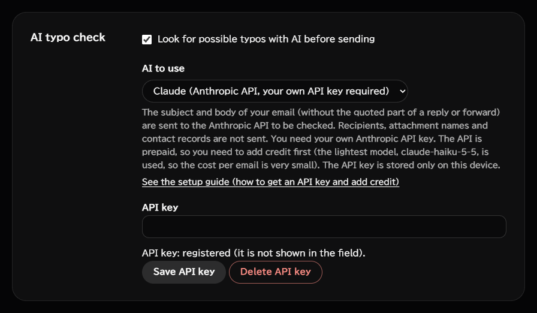

# Setting up the typo check with an external AI (ChatGPT / Claude)

Applies to: the Chrome extension "Send Check for Gmail"

Last updated: November 25, 2026

By default, the typo check uses the AI built into Chrome, which only works on devices that meet Chrome's requirements (such as 22 GB of free space). On other devices you can still use the typo check by connecting the ChatGPT (OpenAI) or Claude (Anthropic) API as described here.

## 1. Before you start

- **You connect your own API.** You contract with OpenAI or Anthropic and register your own API key in the extension. The fees are charged to your account.
- **The APIs are prepaid. You need to add credit first.** The monthly cost is close to zero, but nothing works without a balance.
- **This is separate from a ChatGPT or Claude subscription.** The API is set up in the provider's developer console, apart from the chat subscription.
- **The subject and body of your email are sent to the provider you choose.** If your organization does not allow sending email content to an external AI, do not set this up; use the AI built into Chrome.

## 2. Choose one

| AI      | Provider  | Model (chosen automatically) | Price per 1M tokens        |
| ------- | --------- | ---------------------------- | -------------------------- |
| ChatGPT | OpenAI    | `gpt-6-luna`                 | $0.10 input / $0.50 output |
| Claude  | Anthropic | `claude-haiku-5-5`           | $0.10 input / $0.50 output |

Prices are as of November 2026. Check each provider's page for current prices.

**Rough cost**: checking one email costs about $0.0002. A thousand emails cost about $0.20. It varies with the length of the email.

## 3. ChatGPT (OpenAI)

1. Open <https://platform.openai.com/>, create an account and log in.
2. Open the billing page (<https://platform.openai.com/account/billing>), add a payment method and buy credit. The minimum is $5.
3. Open the API keys page (<https://platform.openai.com/api-keys>) and create a new key.
4. Copy the key. **The full key is shown only when you create it.**

- Purchased credit expires (after one year; after 180 days for credit bought in Japan, according to OpenAI as of November 2026).
- Leave auto-recharge off unless you need it.

## 4. Claude (Anthropic)

1. Open <https://platform.claude.com/>, create an account and log in.
2. Open the billing page (<https://platform.claude.com/settings/billing>) and buy credit with "Buy credits". Follow the screen for the minimum amount.
3. Open the API keys page (<https://platform.claude.com/settings/keys>) and create a new key.
4. Copy the key when it is created.

- Credit expires one year after purchase (according to Anthropic as of November 2026).

## 5. Register the key in the extension

1. Open the options page of "Send Check for Gmail" (right-click the extension icon → Options).
2. Under "AI typo check", choose ChatGPT or Claude in "AI to use".
3. Paste the key into "API key" and press "Save API key".

   

4. Chrome asks whether to allow the connection. Allow it. The setup is done when "API key: registered" is shown.

   

   It looks the same when you choose Claude.

   

5. Tick "Look for possible typos with AI before sending".
6. Press "Save" at the bottom of the page.
7. Reload any open Gmail tabs.

## 6. Check that it works

1. In Gmail, write an email to yourself with a deliberate typo in the body.
2. Press Send. The confirmation screen opens, and after a few seconds the suggestions appear under "Possible typos (AI)".
3. Close it with "Cancel (back to editing)".

## 7. Troubleshooting

| Message on the confirmation screen                    | Cause and what to do                                                                                                                                                              |
| ----------------------------------------------------- | --------------------------------------------------------------------------------------------------------------------------------------------------------------------------------- |
| The external AI cannot be used.                       | Check the API key state on the options page. If it is not registered, save the key. If the connection is not allowed, press "Save API key" again and allow it.                    |
| The AI check could not be run.                        | A mistyped key, an empty or expired balance, or a network problem. Check your balance and key in the provider's console. Creating a new key and registering it again often helps. |
| No candidates were found.                             | The AI found no mistakes. It cannot find every typo, and suggestions that change the meaning or only rephrase the text are deliberately not shown.                                |
| The "Possible typos (AI)" section is missing entirely | The AI check is not ticked, or the settings were not saved. After saving, reload the Gmail tab.                                                                                   |

In every case, sending itself is not blocked.

## 8. What is sent

| Sent                                                      | Not sent                               |
| --------------------------------------------------------- | -------------------------------------- |
| Subject                                                   | Recipients (To / Cc / Bcc)             |
| Body (for a long email, about the first 4,000 characters) | The sender address                     |
| Your API key (only to the provider you chose)             | Attachments and their names            |
|                                                           | The quoted part of a reply or forward  |
|                                                           | Contact records, and email you receive |

- Data is sent only to the API of the provider you chose. Nothing is sent to the developer of the extension.
- It is sent when you perform the send action and the confirmation screen opens.
- To keep the cost small, the lightest model is used and the AI returns only "wrong text → suggestion".
- What is sent is handled under each provider's terms and privacy policy.

## 9. Stopping

- Switch "AI to use" back to "AI built into Chrome" and save. Nothing more is sent.
- "Delete API key" removes the key from your device and withdraws the connection permission.
- It is safer to delete the unused key in the provider's console as well.

## 10. Handling your API key

- Treat the API key like a password. Do not share it or paste it into email or chat. Anyone who has it can spend your balance.
- The key is stored only in Chrome on your device.
- If the key may have leaked, delete it in the provider's console, create a new one and register it again.

The images are made for this guide. Screens of the OpenAI and Anthropic consoles are not included, because they may change; follow what each console shows.

Related: [Privacy Policy](privacy-policy.en.md)
