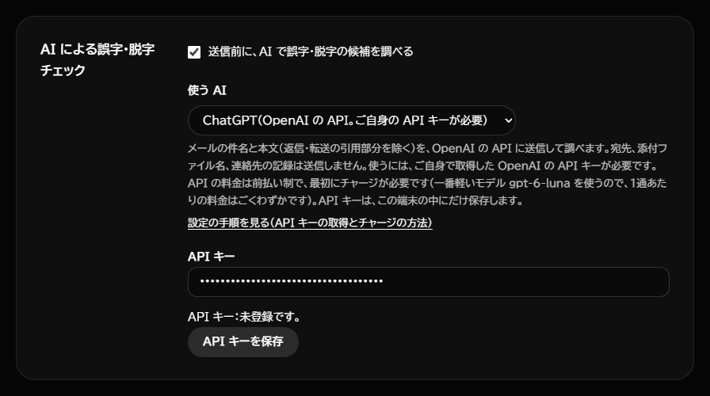
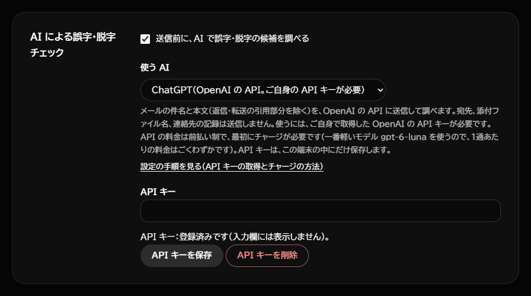
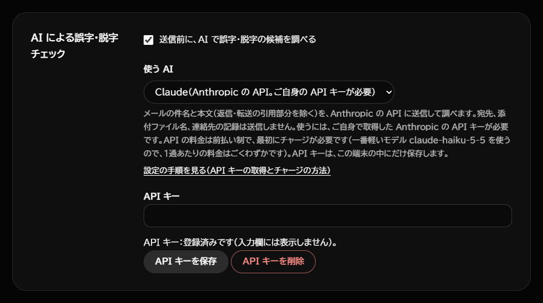
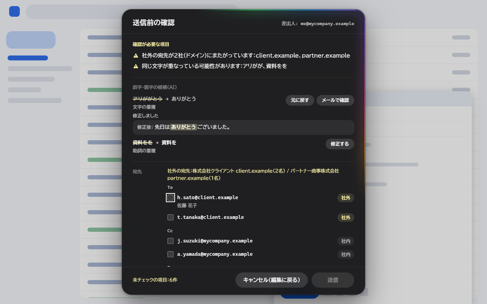

# 外部の AI（ChatGPT／Claude）で誤字・脱字チェックをする設定

対象：Chrome 拡張機能「Send Check for Gmail」

最終更新日：2026年11月25日

誤字・脱字チェックは、初期設定では Chrome に内蔵された AI を使います。内蔵の AI は、空き容量 22GB 以上などの条件を満たす端末でしか使えません。条件を満たさない端末でも、このページの手順で ChatGPT（OpenAI）または Claude（Anthropic）の API をつなげば、誤字・脱字チェックを使えます。

## 1. 先に知っておくこと

- **つなぐのは、あなた自身の API です。** あなたが OpenAI か Anthropic と契約し、あなたの API キーを拡張機能に登録します。料金は、あなたのアカウントに請求されます。
- **料金は前払い制です。最初にチャージが必要です。** 月々の利用料はほぼゼロに近い金額ですが、残高が無いと動きません。
- **ChatGPT や Claude の月額プランとは別です。** API は、チャットの画面の月額プランとは別に、開発者向けの画面で申し込みます。月額プランに入っていても、API の残高が無ければ動きません。
- **メールの件名と本文が、選んだ会社に送信されます。** 会社の決まりで、メールの内容を外部の AI に送れない場合は、この設定をせず、Chrome に内蔵された AI を使ってください。

## 2. どちらか一方を選ぶ

どちらを選んでも、料金と使い方はほぼ同じです。すでにアカウントを持っているほうを選ぶのが簡単です。

| 選ぶ AI | 会社      | 使うモデル（自動で決まります） | 料金（100万トークンあたり）    |
| ------- | --------- | ------------------------------ | ------------------------------ |
| ChatGPT | OpenAI    | `gpt-6-luna`                   | 入力 0.10 ドル／出力 0.50 ドル |
| Claude  | Anthropic | `claude-haiku-5-5`             | 入力 0.10 ドル／出力 0.50 ドル |

料金は 2026年11月時点のものです。最新の料金は、各社のページで確認してください。

**料金の目安**：メール1通のチェックは、おおよそ 0.0002 ドル（約 0.03 円）です。1,000通で約 0.2 ドル（約 30 円）です。メールの長さで前後します。

## 3. ChatGPT（OpenAI）を使う場合

1. <https://platform.openai.com/> を開き、アカウントを作ってログインします。
2. 支払いの画面（<https://platform.openai.com/account/billing>）を開き、支払い方法を登録して、残高をチャージします。最低額は 5 ドルです。
3. API キーの画面（<https://platform.openai.com/api-keys>）を開き、新しいキーを作ります。
4. 表示されたキーをコピーします。**キーの全体が表示されるのは、作ったときだけです。** 閉じる前にコピーしてください。

- 日本で買った残高は、買ってから 180 日で期限が切れます（2026年11月時点の OpenAI の案内）。使い切れない額を一度に入れないようにしてください。
- 自動チャージ（残高が減ると自動で買い足す設定）は、必要なければオフのままにしてください。

## 4. Claude（Anthropic）を使う場合

1. <https://platform.claude.com/> を開き、アカウントを作ってログインします。
2. 支払いの画面（<https://platform.claude.com/settings/billing>）を開き、「Buy credits」から残高をチャージします。最低額は、画面の表示に従ってください。
3. API キーの画面（<https://platform.claude.com/settings/keys>）を開き、新しいキーを作ります。
4. 表示されたキーをコピーします。あとから見直せないことがあるので、作ったときにコピーしてください。

- 残高は、買ってから 1 年で期限が切れます（2026年11月時点の Anthropic の案内）。

## 5. 拡張機能に登録する

1. Chrome の右上の拡張機能のアイコンから「Send Check for Gmail」の設定画面を開きます（拡張機能のアイコンを右クリック →「オプション」）。
2. 「AI による誤字・脱字チェック」の「使う AI」で、ChatGPT か Claude を選びます。
3. 「API キー」の欄に、コピーしたキーを貼り付けて、「API キーを保存」を押します。

   

4. Chrome が「通信を許可しますか」と尋ねるので、許可します。「API キー：登録済みです」と表示されれば完了です。

   

   Claude を選んだ場合も、同じ表示になります。

   

5. 「送信前に、AI で誤字・脱字の候補を調べる」にチェックを入れます。
6. 画面の下の「保存」を押します。
7. 開いている Gmail のタブを再読み込みします。

## 6. 動作を確かめる

1. Gmail で、自分宛てのメールを作ります。本文に、わざと誤字を入れます（例：「資料をを送付いたします。」）。
2. 送信ボタンを押します。確認の画面が開き、数秒後に「誤字・脱字の候補（AI）」の欄に候補が表示されれば、正しく動いています。

   

3. 「キャンセル（編集に戻る）」で閉じます。

## 7. うまくいかないとき

| 確認の画面の表示                                                       | 原因と対処                                                                                                                                                                                     |
| ---------------------------------------------------------------------- | ---------------------------------------------------------------------------------------------------------------------------------------------------------------------------------------------- |
| 外部の AI を使えません。API キーが未登録か、通信が許可されていません。 | 設定画面で API キーの状態を見てください。「未登録」ならキーを保存します。「通信が許可されていません」なら、もう一度「API キーを保存」を押して、通信を許可します。                              |
| AI チェックは実行できませんでした。                                    | キーの貼り間違い、残高の不足・期限切れ、通信の不調のどれかです。各社の画面で、残高とキーが有効かを確かめてください。キーを作り直して、登録し直すのも有効です。時間をおいて直ることもあります。 |
| 候補は見つかりませんでした。                                           | AI が誤りを見つけなかったときの表示です。AI は、すべての誤字を見つけられるわけではありません。意味を変える修正や、言い回しを変えるだけの修正は、安全のために表示しないようにしています。       |
| 「誤字・脱字の候補（AI）」の欄そのものが無い                           | 「送信前に、AI で誤字・脱字の候補を調べる」にチェックが入っていないか、設定を保存していません。保存したあとは、Gmail のタブを再読み込みしてください。                                          |

どの場合も、メールの送信そのものは止まりません。AI のチェックに失敗しても、宛先と添付の確認をすれば、そのまま送信できます。

## 8. 送信される内容

| 送信するもの                                  | 送信しないもの             |
| --------------------------------------------- | -------------------------- |
| 件名                                          | 宛先（To / Cc / Bcc）      |
| 本文（長いメールは、先頭の約 4,000 文字まで） | 送信元のアドレス           |
| API キー（選んだ会社にだけ）                  | 添付ファイルと、その名前   |
|                                               | 返信・転送の引用部分       |
|                                               | 連絡先の記録、届いたメール |

- 送信先は、選んだ会社の API だけです。拡張機能の開発者には、何も送信されません。
- 送信するのは、送信の操作をして確認の画面が開いたときです。
- 料金を抑えるため、一番軽いモデルを使い、AI の返答は「誤りの箇所 → 修正案」だけにしています。
- 送信した内容の取り扱いは、各社の規約とプライバシーポリシーに従います。

## 9. やめるとき

- 設定画面の「使う AI」を「Chrome に内蔵された AI」に戻して保存すると、外部への送信は止まります。
- 「API キーを削除」を押すと、端末に保存したキーが消え、通信の許可も取り下げられます。
- 使わなくなったキーは、各社の API キーの画面でも削除しておくと安全です。

## 10. API キーの取り扱い

- API キーは、パスワードと同じように扱ってください。ほかの人に教えたり、メールやチャットに貼ったりしないでください。キーを知った人は、あなたの残高を使えます。
- キーは、あなたの端末の Chrome の中にだけ保存されます。
- キーが漏れたかもしれないときは、各社の API キーの画面でそのキーを削除し、新しいキーを作って登録し直してください。

画像は、説明用に作った画面です。写っているアドレスや名前は架空のものです。OpenAI・Anthropic の画面の画像は、載せていません（各社の画面は変わることがあるため、表示に従って進めてください）。

関連：[プライバシーポリシー](privacy-policy.md)
